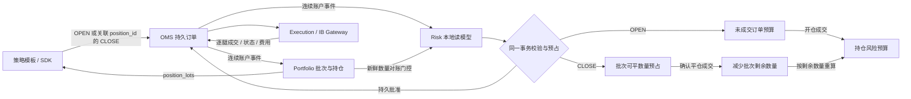

# 平仓与持仓风险闭环

范围：在已有四仓库基础设施内完善数量归属、平仓预占和风险预算释放；不写策略，不新增进程，不做统一监控、期权到期／指派或行情回放。使用本机模拟联调，不新增 IB 订单。

每个开仓订单形成一个持仓批次，`position_id` 等于开仓订单 ID。新增 `OrderIntent.close_position_id`；SINGLE CLOSE 只允许卖出该批次的股票／单腿多头期权，VERTICAL_CLOSE 只允许反向完整关闭对应 bear call / bull put 两条腿，不能混用其他策略、其他开仓批次或外部仓位。改单仍仅修改限价和时效，不能更换批次或数量。

Portfolio 保持原按策略／合约汇总的成本与损益，并在快照增加 `position_lots`（持仓批次、剩余数量和腿）。批次数量不是可平承诺；Risk 在自己的事务内根据同一 OMS 账户序列读模型与已有审批计算可平数量。Risk、Portfolio 共用纯批次计算函数，仍不跨数据库读写。

可平数量＝本批次确认剩余数量－其他活动平仓订单尚未成交的预占数量。申请、预占、审批和 outbox 一起提交；重复请求幂等，改单替换同一订单预占，不重复占用。撤单发出或审批 TTL 到期不能释放数量；只有明确未派发、拒绝或一致的终态才释放未成交部分。腿未齐、不确定发送、更正导致超平、账户事件缺口均阻断。

风险预算分为挂单预占和持仓占用。开仓未成交部分保留订单额度；已成交未平部分按历史有效审批的最高单位预算保留，平仓成交后按剩余数量减少。单腿使用批准限价×乘数与费用缓冲，信用价差使用宽度×乘数与费用缓冲；这是保守配置预算，不是真实保证金、净资产或按市值风险。改单拒绝不保留被明确否决的增量，未知状态不主动释放。

平仓不创建新的开仓预算（持仓本身已占用额度），但必须通过归属／数量／合约／限价／频率／订单数量检查和新鲜 Portfolio 门控；账户或策略 halted 阻止开新风险，允许已验证的减仓。价差平仓限价为正向 DEBIT 且不超过宽度；单腿多头平仓为 SELL/CREDIT。裸卖开仓、拆保护腿、外部持仓自动归属仍拒绝。费用仍由 Portfolio 入账，超出配置费用缓冲仍阻断。

风险转移先处理完整 OMS 事务的事件序列，再审批。持仓批次若只收到部分腿，不宣称可平；Portfolio 的批次视图与 Risk 数量预占各有明确水位。风险读模型同时保存成交事实，检测视图与执行事件不一致，避免只凭终态释放额度。

对现有数据采用保守迁移：可从当前订单视图和审批记录确定的批次兼容；无法核验的历史成交或缺失审批则保持冻结，不删除库重建额度。旧幂等消息使用旧协议哈希时须显式处理兼容，不能把新增默认字段改变的哈希解释为同一旧请求的新经济内容。

验证：协议方向与批次约束；两笔并发平仓；部分成交／取消／改单／拒绝；重复、更正、手续费、重启；不同策略与外部仓位隔离；信用价差两腿顺序；订单额度→持仓额度→部分／全部释放；真实 NATS/PostgreSQL、安装 wheel 的独立进程联调。验证后删除临时测试，不再保留备份归档。

## 契约与接口

- 协议／订单 SDK 0.4.0、Portfolio SDK 0.2.0；账户服务 0.2.0，Execution 0.3.0，策略 API／Runtime 0.6.0，需协调更新。
- `OrderIntent.close_position(position_id, opening_intent, quantity=..., limit_amount=..., deadline_at=...)` 构造反向意图；它不是持仓授权，仍由 Risk 核验。`position_id` 从自身 `ViewSnapshot.position_lots` 获取；`opening_intent` 保留该批次的原始腿身份。
- `position_lots` 包含 `position_id`、`strategy_instance_id`、`opening_intent`、`opened_quantity`、`closed_quantity`、`remaining_quantity`、逐腿 opened/closed/remaining 与 SETTLED/UNSETTLED。`risk_quantity` 是保守预算用的最大剩余腿数，不是额外可平量。只返回尚有敞口或未对齐批次；上限沿用 max_positions，超限拒绝完整快照而非截断。
- Risk 健康查询新增 `pending_risk`、`position_risk`，总和为 `account_committed`；策略分项新增 pending / position。审批 audit 记录审批前额度与 available_to_close。
- 所有 CLOSE 都强制 Portfolio 数量对账与水位门控，即使 SIMULATION 的 `require_portfolio=false`；该配置仅决定 OPEN 是否强制门控。缺少模拟券商快照的旧 Mock 无法授权平仓。
- `halted` 只豁免已经完成持仓验证的减仓，仍检查合约、正限价、单笔上限、数量、频率、活动订单数及自定义规则。未到期期权平仓可在到期日提交；系统仍不负责生命周期处理。

旧 OPEN 意图序列化不输出空的 close_position_id，保持原幂等摘要。Risk 旧账本若没有可核验的历史成交事实，遇到历史成交投影即冻结；只含未成交记录可兼容升级。不得清库或虚构成交来跳过核验。

成交更正若造成实际超平或活动平仓预占超过剩余持仓，回滚该投影、持久冻结并使核心回放失败。统一账户进程退出，Execution 无法再取得新授权；已在券商的委托不会自动撤销，必须核对处理。跨系统授权与券商发送仍非原子操作，不能承诺完全消除更正／发送竞态。

IB 组合限价按买入信用价差负价、反向买入平仓借记正价映射；单腿多头平仓 SELL 使用正限价。依据：[IBKR 组合订单价格说明](https://www.interactivebrokers.co.uk/en/software/tws.bak/usersguidebook/specializedorderentry/notes_on_combination_orders.htm)、[IBKR 组合合约定义](https://www.interactivebrokers.com/docs/tws-api/contracts/combos-spreads)。

