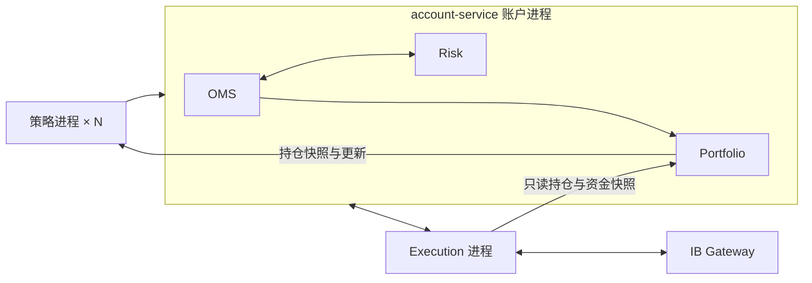

> 0.3.0 当前对账行为以[手工持仓共存](manual-positions.md)为准；下文总量差异阻断是首期背景。

> 当前版本补充：本页保留首期设计／验收背景；平仓和风险转换能力以 [当前闭环说明](close-risk-design.md) 为准。

# Portfolio 与账户进程设计 · 2026-10-14

## 已确认范围

单账户、秒级/分钟级决策、先本机模拟环境。按用户最新决定，OMS、Risk、Portfolio 同仓库同进程，独立模块和数据库；行情、Execution、每个策略实例仍独立进程。已有 IB 仓位列为外部/未分配，不自动归属策略。本轮不新增交易订单，不开放实盘、平仓或单腿卖出；Docker 后续。

## 进程与边界

`src/account_runtime` 只装配生命周期；`oms_service`、`risk_service`、`portfolio_service` 各自持有连接、事务、数据所有权及 NATS 身份。先保留既有消息接口，避免同时改写交易链路。任一模块不可恢复故障则整个账户进程停止；不存在同进程安全沙箱或同等进程故障隔离。数据库角色可进一步限制跨模块写入，但同进程仍共享内存和凭据。

## 账本

以 OMS 持久账户 journal 为唯一策略交易输入，绑定账户/环境/执行模式/feed_epoch；逐条检查 account_seq，重复内容幂等，同序号冲突或缺口冻结。订单更新提供策略和逐腿合约属性；真实逐腿 execution 更新数量，手续费绝对值按版本更新。支持更正引用并重新投影，组合只记腿，不另记 BAG 总量。

策略、合约分别采用移动加权平均成本；减仓实现损益，穿零剩余仓位按成交价建立新成本。期权应用乘数。手续费单独费用化；交易现金流不是账户可用余额。只记 USD 标准股票/期权，券商其他资产仍原样列为外部持仓。未实现盈亏首期不自行估算，不使用缺少时间/权限依据的价格。

## 对账

Execution 保持唯一 IB 连接，通过新请求及完成标志采集持仓、资金摘要，带采集窗口、来源会话、唯一快照 ID 与完整性/稳定性标记。只读查询不会发单。多接口快照不具有全局原子性；采集期间交易回报、待处理回报或 outbox 未清空时标为不稳定。

Portfolio 先追上 OMS 水位，采集券商快照，再追平 OMS。窗口内经济账本变化则待下轮重试，不宣布匹配。每个合约比较策略数量合计与券商实际数量。差额列为外部/未分配或待核对；不据此修改策略持仓。没有差异也只表示本轮持仓数量匹配，不代表资金/税务/保证金完整对账。

快照过期、模式/归属不符、未完成、来源错误、未知映射均不得变为就绪。策略只可读取自身持仓；账户详情只给 Risk/operator。资金摘要保留券商币种、标签和采集时间，不把净资产当作可用资金。Risk 可配置要求最新匹配的 Portfolio 视图，仍保留现有预占，不自动释放成交后的额度。

## 接口与部署

Portfolio 的 SDK 与读模型放本仓库 `packages/portfolio-client`，随固定版本 wheel 安装到策略和 Execution，不新建公共库仓库。策略 `ctx.portfolio.snapshot()` 和 `on_position_update` 读取带水位的完整视图；更新可合并，不能作为逐笔成交再累加持仓。恢复先交付最新快照，持续变化通过串行回调。

入口 `account-runtime` 启动 OMS → Portfolio → Risk，统一退出；保留 `oms`、`risk`、`portfolio` 单模块入口便于排障。固定版本、独立服务 NATS ACL、数据库单写锁、防止同时启动统一入口与单模块入口。Execution 可使用只读账户模式进行联调，不启用订单消费者。

## 验证与限制

验证多策略同合约、价差逐腿、反向/穿零、重复、更正、费用乱序、序列缺口、重启重建、权限隔离、快照过期及采集竞争；真实本机 IB 只读查询另记录，不把合成成交称为 IB 成交。到期/指派/公司行动、资金出入、自动差异修复、完整估值和 Portfolio 驱动的平仓授权留待后续。

依据：[IB 持仓接口](https://interactivebrokers.github.io/tws-api/positions.html)、[IB 账户更新](https://www.interactivebrokers.com/docs/tws-api/doc/account-portfolio-data/account-updates/receiving-account-updates)、[ib_async 2.1 文档](https://ib-api-reloaded.github.io/ib_async/api.html)。
