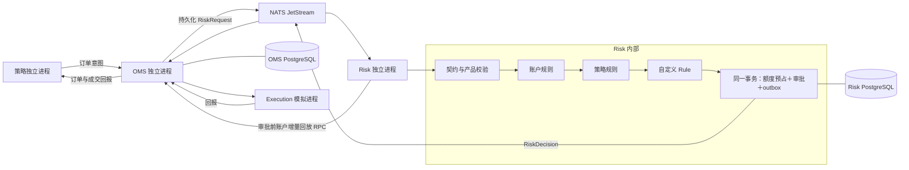

> 仓库与部署更新：Risk 现为 account-service 内部模块，与 OMS、Portfolio 同进程，规则和数据边界不变。见 [当前模块边界](operations.md)。

# Risk v0.1 设计

## 范围和职责

一个账户一个 Risk 写入进程，同时执行账户级规则和策略级规则；两层必须全部通过。规则可扩展，但事务、身份验证、额度预占、回放、幂等和故障拒绝是核心行为，不能由策略绕过。独立 `risk` Git 仓库，只依赖 OMS 仓库发布的 `oms-protocol` wheel，不导入 OMS 服务代码，不访问 OMS 数据库。

用户确认首期只运行本机模拟：买入股票开仓、买入单腿期权开仓、bear call / bull put 信用价差开仓。单腿卖出、股票做空、所有平仓、行权/指派处理等待持仓模块；Docker 留到 Linux 部署阶段。`paper / SIMULATION` 写死为服务支持的环境，`trade_ready=false`。

## 数据流

OMS 拥有订单/成交事实与账户序列；Risk 拥有风险额度账本、审批记录及账户事件投影。账户事件通过专属、受 NATS ACL 保护的 `rpc.oms-risk` 接口回放；每次审批前查询最新 head 并回放到该水位，空闲时每 0.5 秒增量回放。个人规模下使用这条统一恢复路径，无需再维护独立推送游标。回放按 epoch + account_seq 连续应用，数据和游标一起提交；回放断档、身份冲突、OMS 数据库换代都拒绝继续审批。

## 内部目录

| 文件 | 职责 |
|---|---|
| `config.py` | 明确的策略限额、账户限额、运营者提供的模拟合约目录 |
| `policies.py` | 无 I/O 的产品校验、双层规则、`Rule` / `Context` 扩展接口 |
| `ledger.py` | 每订单预占、成交占用保留及权威回报释放 |
| `service.py` | 回放与审批事务、幂等、审计、健康状态 |
| `storage.py`、`sql/` | 独立 PostgreSQL 存储、数据库单写者锁 |
| `transport.py` | 账户回放 RPC、请求消费和审批 outbox 发布 |
| `app.py` | 生命周期、信号退出、扩展规则装配 |

## 风险口径

以 USD 保守承诺额度计账，**不是可用现金、IB 保证金或当前组合最大损失**。合约乘数取 Risk 配置目录，不信任策略传入的声明；首期只接受普通股票（乘数 1）、标准 100 股美股期权（乘数 100）。调整合约不支持。目录 ID/version 必须与订单一致，期权标的/到期日/权利方向/行权价必须逐一吻合。示例 `SIM_` ID 仅用于模拟，不是实际券商合约。

| 产品 | 预占额度 |
|---|---|
| 买入股票/单腿期权 | 限价 × 数量 × 乘数 + 费用缓冲 |
| bear call / bull put | 行权价差 × 数量 × 乘数 + 两腿费用缓冲 |

价差另记录到期理论最大损失 `(行权价差 − 净收入) × 数量 × 乘数`，仅供审计；不把尚未收到的权利金当作可复用余额。该到期损益边界不涵盖提前指派或不平衡腿期间的股票/裸腿风险。双腿未平衡时暂拒新审批，UNKNOWN/对账异常持久阻断。首期只能模拟，真实组合执行与持仓/指派风险尚未闭环。[OIC bear call 说明](https://www.optionseducation.org/strategies/all-strategies/bear-call-spread-credit-call-spread)、[OIC 指派说明](https://www.optionseducation.org/news/trading-options-understanding-assignment)。

账户与策略分别检查：暂停开关、单笔成本、总承诺额度、未完成订单数、股票/期权数量、每分钟请求数。请求数包含拒绝和改单，重复 message_id 不重复计数。平台还检查决策年龄、请求期限、最低 DTE（纽约日期）及产品范围。额度是配置示例，不是资金管理建议。当前未接入实时行情质量、价格偏离、Greeks、净值、日损或真实 buying power；接口预留，不能宣称已有这些规则。

## 额度生命周期

1. 风控按 request_id + 完整载荷哈希幂等；重复请求返回同一审批与 reservation_id。审批、预占、outbox 同一 PostgreSQL 事务，提交后 ACK 请求，PubAck 后标记 outbox 已发布。
2. 同一数据库写锁串行完成账户与策略检查及预占，不允许多个策略同时穿透剩余额度。单进程故障不自动切换第二个写者；数据库 session advisory lock 拒绝第二进程。
3. 同一逻辑订单的多个有效审批取最大占用。改单只预占增量，旧额度保留；拒绝或 NOT_DISPATCHED 释放对应新预占。明确未执行的改单预占不会因后续成交复活；成功降价暂不释放有效历史高水位，直到有无成交的终态证据，偏保守。
4. 审批 TTL 只限制下游使用资格，**不自动释放预占**，因为指令可能已离开 OMS。撤单请求、重启、断连同样不能释放。
5. 明确无成交、无异常的 CANCELLED / REJECTED / EXPIRED 终态释放；成交后无论 FILLED、部分成交后撤单、成交更正或归零，都保留完整保守占用，等待未来 Portfolio 可靠接管。不会按天重置。晚到成交恢复历史占用，异常阻断；手续费超过缓冲要求核对。
6. Risk 库不能靠重新回放 OMS 事实重建已经丢失的审批账本。回放见到未预占的已派单/已成交订单，或当前/待执行改单意图版本没有对应审批，即阻断，必须恢复 Risk 备份。首期采用两个新模拟数据库启动。

## 扩展方式

`Rule.check(Context) -> None | str`：None 通过，稳定错误码拒绝。规则无网络/数据库 I/O，不改变额度；异常默认拒绝。运营者安装自己的 Python 包后，在 `extra_rules` 写 `package.module:RuleClass`。基础校验始终先执行，插件不能放宽平台与账户上限。策略实例只提交意图，不能选择或禁用规则。

后续持仓模块提供带账户序列与新鲜度的资产/持仓快照、成交及指派核对，再设计已成交额度向持仓风险转移的原子协议；之后开放平仓和有明确担保/保证金口径的单腿卖出。新产品扩展成本模型与合约资格校验；新规则可直接加插件；多账户可独立部署 Risk/OMS 与数据库。首期不提前搭建空的 Portfolio/Greeks/实时保证金模块。
